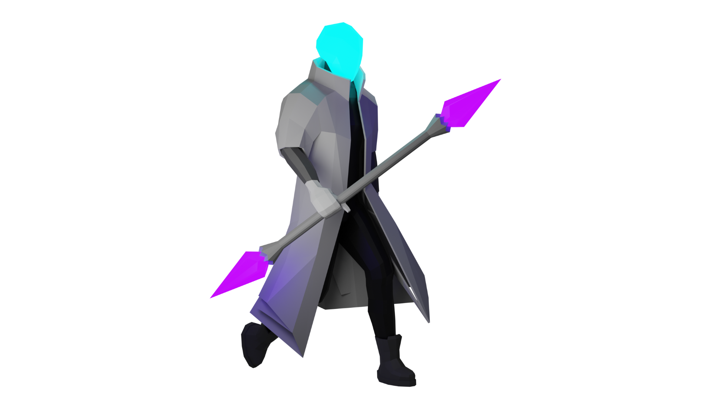
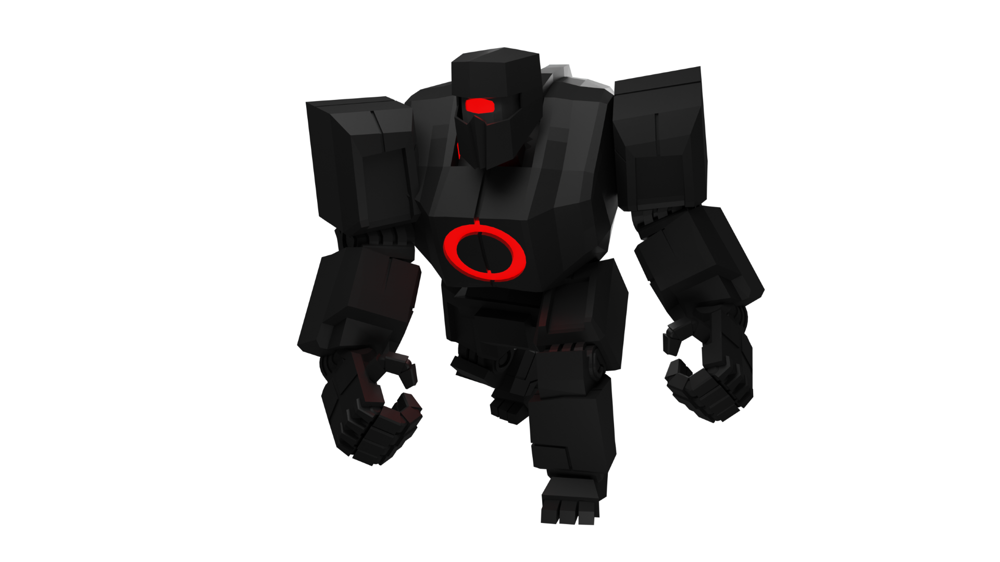
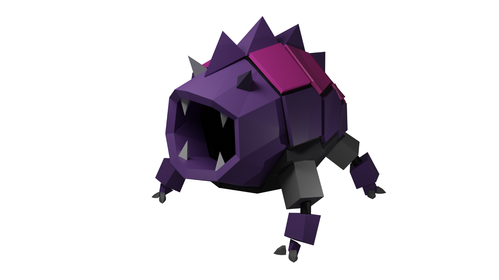
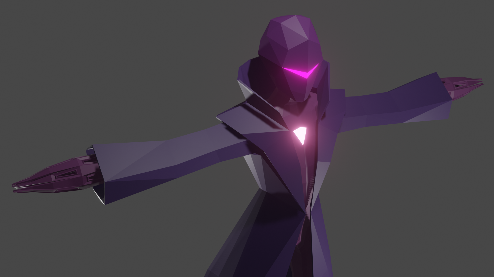
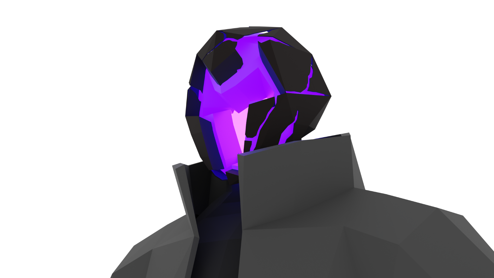
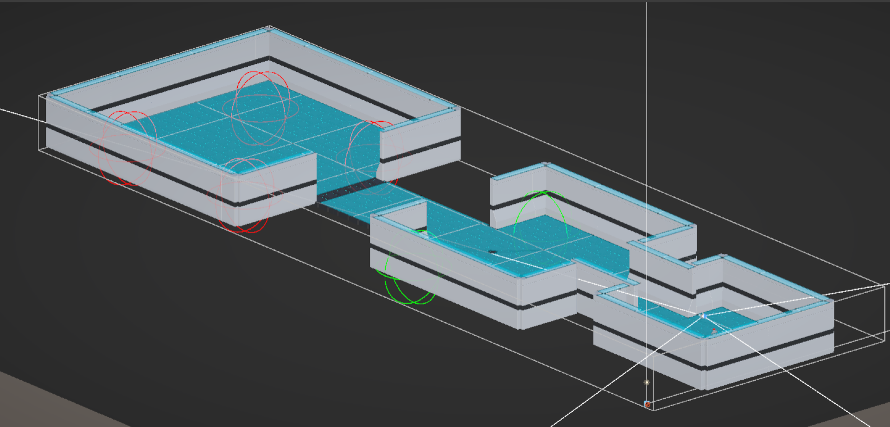
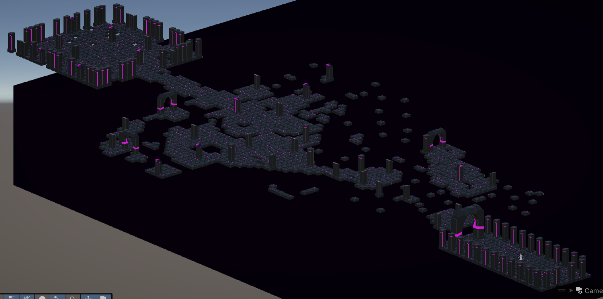
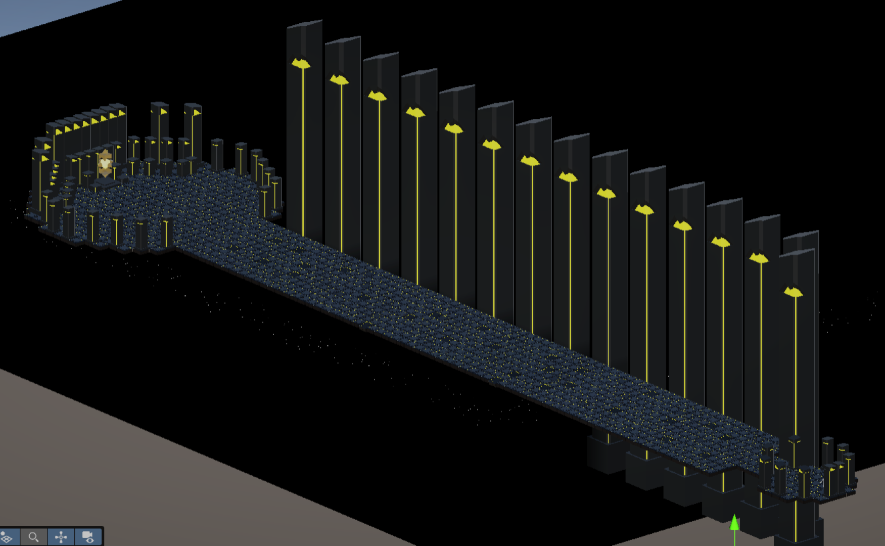
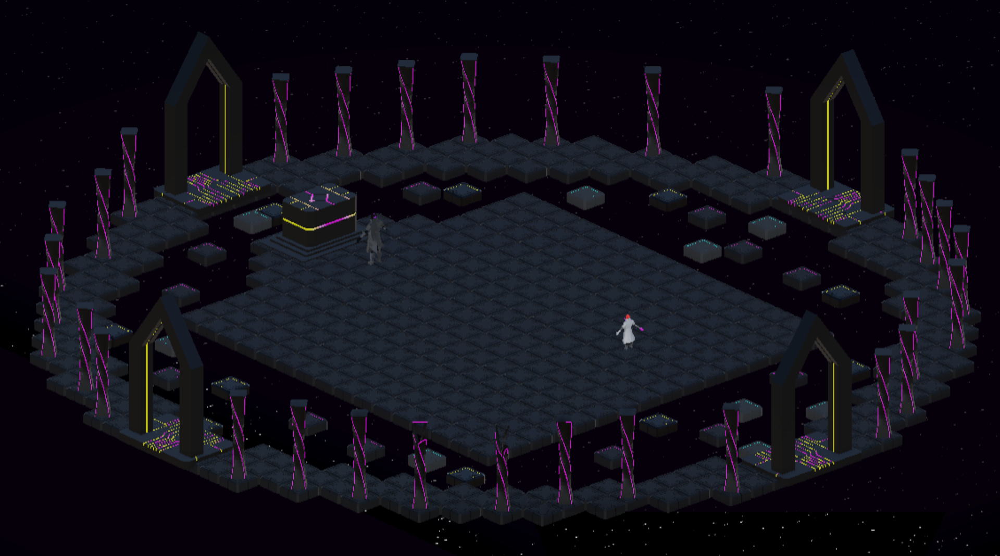

# Gameplay e sistemi

## Struttura della demo

La demo giocabile è composta da **tre livelli e un'arena finale**. Ogni livello introduce un'area distinta, con corridoi, piattaforme e incontri con i nemici. Le arene bloccano temporaneamente l'area e gestiscono le ondate da completare per proseguire. La durata media indicativa della demo è di 15–30 minuti e varia in base all'abilità del giocatore.

## Aster e combattimento

Aster è il protagonista controllato dal giocatore.

  

I sistemi implementati comprendono movimento, gestione della vita e dei danni, stati cromatici, combattimento e combo.

Lo **Stylus** è l'arma da combattimento ravvicinato. Il sistema supporta attacchi concatenati e gestione dei danni.

Il **Vettore di Collisione** è un dash offensivo: Aster attraversa lo spazio e può danneggiare i nemici.

## Nemici e boss

La navigazione dei nemici utilizza Unity NavMesh. Lo spawn nel mondo è randomizzato a partire da punti predefiniti, con parametri per quantità e raggio.

La demo presenta quattro avversari identificati nella documentazione visiva:

| Nemico | Identità visiva |
|---|---|
| **Logic Error** | Creatura grande, nera e corazzata. |
| **Memory Leak** | Piccola creatura simile a un cane. |
| **Runtime Exception** | Creatura dalle forme e tonalità viola. |
| **Critical Failure** | Boss finale, rappresentato come una figura imponente e contrapposta ad Aster. |

  
  
  
  

**Critical Failure** è il boss finale. È stato realizzato come controparte di Aster e utilizza il dash come attacco e comportamento di inseguimento; non dispone dello Stylus.

## Livelli e ambienti

### Livello 1 – Tutorial

La prima area introduce il giocatore al percorso e alle meccaniche di base. È caratterizzata da una palette prevalentemente celeste.

  

### Livello 2 – Percorso viola

Il secondo livello è caratterizzato da un lungo percorso viola e da blocchi sospesi e piattaforme separate.

  

### Livello 3 – Percorso dorato

Il terzo livello introduce una palette con elementi dorati e una diversa configurazione del percorso.

  

### Arena finale

L'arena finale ospita lo scontro conclusivo contro Critical Failure.

  

## Arene e ambiente

Le arene sono configurate in anticipo e gestiscono il blocco dell'area e le ondate di nemici. La distribuzione dei nemici nel resto del mondo utilizza punti di spawn e parametri configurabili.

La de-allocazione dinamica agisce sulle singole piattaforme: queste si disattivano/scompaiono e in seguito ricompaiono e risalgono.

## Fallimento e respawn

È presente il respawn quando Aster cade fuori dal mondo e in seguito al Game Over. Non sono presenti checkpoint intermedi.

## Elementi non completati

Il sistema completo di progressione previsto dal GDD non è stato implementato. UI/HUD, menu e alcuni shader/VFX sono parziali. Il menu disponibile è minimale e consente di mettere in pausa, iniziare o uscire.
